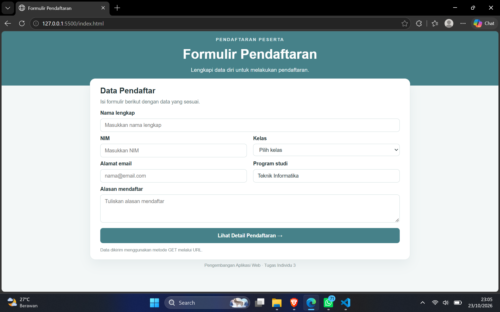
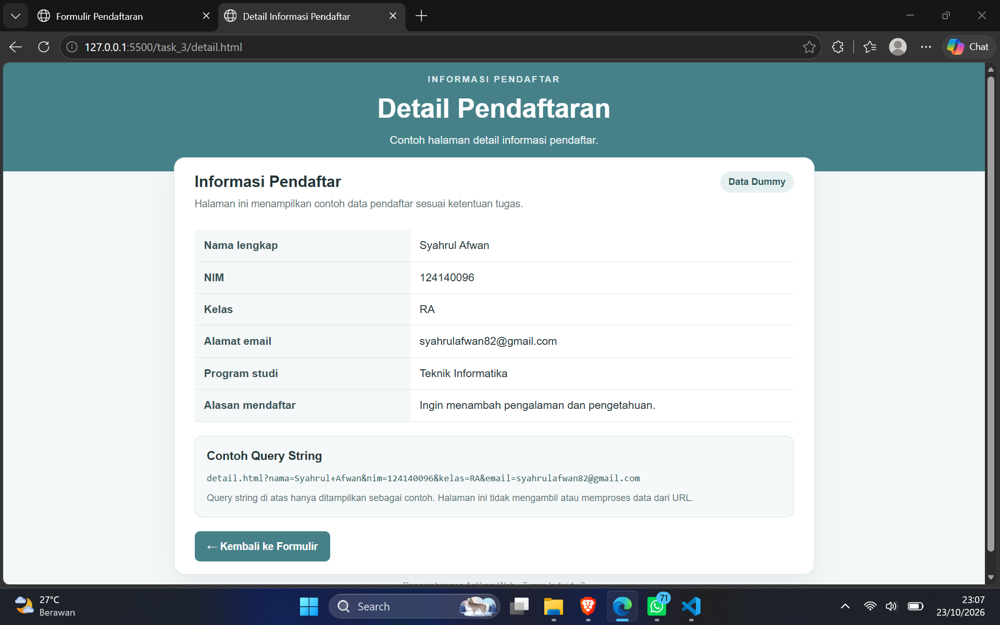

# Tugas Individu 3 — Pemrograman Web

## Deskripsi

Proyek ini berisi dua halaman web sederhana sesuai instruksi Tugas Individu 3 pada modul Pertemuan 4:

- Halaman pendaftaran menggunakan formulir dengan metode `GET`.
- Halaman detail informasi pendaftar sebagai halaman dummy.
- Query string digunakan untuk meneruskan data dari halaman pendaftaran ke halaman detail. Data tidak diproses atau ditangkap di halaman detail.

## Fungsi File

| File          | Fungsi                                                                                                                                             |
| ------------- | -------------------------------------------------------------------------------------------------------------------------------------------------- |
| `index.html`  | Halaman pendaftaran yang berisi formulir untuk memasukkan informasi pendaftar. Formulir menggunakan metode `GET` untuk mengirim nilai melalui URL. |
| `detail.html` | Halaman detail informasi pendaftar. Halaman ini dibuat sebagai tampilan dummy sesuai instruksi tugas.                                              |
| `style.css`   | Mengatur tampilan kedua halaman, termasuk layout, box, tabel, formulir, serta penyesuaian tampilan untuk layar berbeda.                            |

## Alur Formulir dan Query String

1. Buka `index.html` melalui browser.
2. Isi formulir pendaftaran lalu tekan tombol kirim.
3. Metode `GET` menambahkan nilai formulir ke URL sebagai query string.
4. Query string digunakan untuk menuju halaman detail sesuai rancangan tugas. Halaman detail tidak diwajibkan menangkap atau memproses nilai tersebut.

## Screenshot Tampilan

Tambahkan screenshot hasil tampilan proyek pada tabel berikut.

| File                   | Screenshot                                            |
| ---------------------- | ----------------------------------------------------- |
| Halaman Pendaftaran    |  |
| Halaman Detail Peserta |       |

## Cara Menjalankan

1. Buka folder proyek di Visual Studio Code.
2. Buka file `index.html` menggunakan browser.
3. Isi dan kirim formulir untuk melihat alur GET dan query string.
